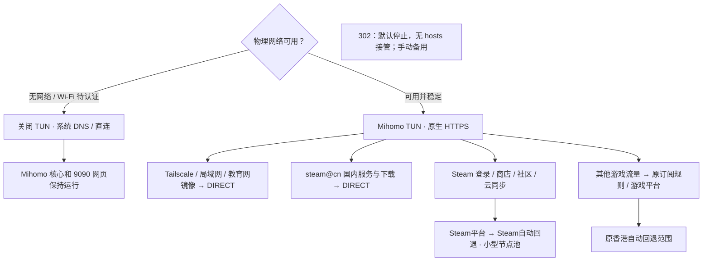

# Steam Deck 网络

默认由 Mihomo 接管需要代理的流量，使用原生 HTTPS；Steamcommunity 302 保留安装、默认停用。
系统 DNS 由 NetworkManager、systemd-resolved 和 Tailscale 协作管理。SteamOS 保持只读，
不修改 Steam 容器、证书库或客户端更新会覆盖的文件。

## 当前路径



| 内容 | 默认处理 |
| --- | --- |
| Steam 登录 API、商店、社区、聊天、非国内更新地址 | `🎮 Steam平台` → `🎮 Steam自动回退`，独立于游戏节点选择 |
| `steam@cn` 中的国内服务、下载 CDN | 优先 DIRECT；保留订阅原有的国内分类 |
| Google 承载的 Steam 云存储 | Steam 平台回退组 |
| `steamconnecttest.com` | DIRECT，让 Steam 看到实际网络连通性 |
| 游戏联机流量 | 按实际域名/IP 命中订阅；不按整个 Steam 进程强制代理 |
| Tailscale、局域网、链路本地地址 | TUN 排除接口/网段，前置直连规则；MagicDNS 保留独立解析 |
| 教育网联合镜像及成员站 | DIRECT |
| 302 | 不自启、不写 hosts、不启用 DNS 接管，手动打开才使用 |

`steam@cn` 包含部分服务域名，并不等同于“所有下载”或“任何网络下都可直连”。
HTTPS 健康检查也不能证明某个游戏的 UDP 链路可用。遇到个别目的地失败，应查看实际命中规则，
针对该目的地调整；不把全部 Steam 下载改走代理。

MetaCubeXD 只是控制页面，业务流量不经过网页。Deck 本机使用
`http://127.0.0.1:9090/ui/`，其他 tailnet 设备使用 `http://Deck的TailscaleIPv4:9090/ui/`。
防火墙仅允许本机和 Tailscale 接口访问 9090，遵循 tailnet ACL，无需网页密码。

## 网络状态与恢复

- 启动先使用待机配置：核心和网页启动，TUN 关闭，不进行自动节点测速或远程 provider 更新。
- 使用 NetworkManager / logind 事件，30 秒低频复核。只有有默认网关的物理接口算外网连接。
- 断开物理网络持续约 10 秒后进入 `offline`；认证门户进入 `portal` 并释放 TUN/DNS。
- 新网络连通性不明时，保持原生 DNS 和直连，尝试两个不跟随重定向的 HTTP 连通性检查。
  认证门户约每 30 秒检查；受限网络逐步延长到最多 120 秒。不提交 Wi-Fi 登录表单。
- 已认证的网络稳定约 3 秒后恢复之前的运行模式和 TUN 开关。切换网络、IP/DNS 变化、
  休眠恢复都会重新判断。已建立网络的一次 `limited` 探测不会造成代理反复启停。
- 所有限定节点失败时，只暂停受影响的组并按退避间隔重试，不切换到其他地区，
  不改变全局模式，也不影响 Tailscale、局域网、国内下载。详见 [节点恢复](steamdeck-mihomo.md#节点全部失效时)。

休眠期间进程不运行；唤醒事件和 Linux 休眠时钟差都能触发重新判断。
本机网页始终保留，Tailscale 远程网页则仍需要真实网络连接。
认证 Wi-Fi 的登录可以在游戏模式的网络入口或桌面浏览器完成。
两个检查端点都被当前网络拦截时，可能维持 `limited`；可以先用普通网页确认是否尚需认证，
查看 `workbench mihomo status`，而不是反复手动测速所有节点。

## 统一命令

```sh
workbench list --category network
workbench mihomo status
workbench mihomo open
workbench mihomo check
workbench tailscale check
workbench steamcommunity302 check
workbench system check steamdeck
```

Zsh 支持分层 Tab 补全。所有网络组件使用相同操作：

| 操作 | 含义 |
| --- | --- |
| `install` | 安装固定版本客户端、菜单和配置；保留正在运行的服务 |
| `apply` | 本机完成管理员授权；302 的此操作是恢复默认停用状态 |
| `update` | Mihomo 刷新订阅；302 对齐固定客户端版本；Tailscale 用官方安装器更新稳定版 |
| `start` / `stop` / `restart` | 操作后台；不会修改开机启用设置 |
| `status` / `check` / `logs` | 查看状态、检查运行条件、查看日志 |
| `open` | 打开网页或客户端 |

`workbench mihomo stop` 会停止核心及管理进程；网络恢复或订阅定时任务不会擅自启动它。
Mihomo 的日常切换、重启和更新不需要 sudo。Tailscale 的更新、停止、重启需要在本机执行，
以免切断用于管理它的 SSH；Tailscale 和 302 的系统服务操作需要管理员权限。

302 是备用工具，`inactive` 是正常状态。需要备用时显式执行
`workbench steamcommunity302 open`，在官方 GUI 中配置后台及所需规则。
重新启用 hosts 拦截可能再次引入 Steam 容器 TLS 问题，系统信任 302 CA 不代表 Steam 容器也信任。
用完后在本机执行 `workbench steamcommunity302 apply`：停止并禁用自启，关闭 hosts/DNS 管理，
清除带 `#S302` 标记的 hosts 条目。客户端、设置和数据保留。
普通 `stop` 只停服务，不清 hosts，不能代替这个恢复步骤。

## 重建与持久化

项目位于 `~/Software/src/workbench`；订阅、策略偏好和运行数据在仓库外。

```sh
workbench profile apply --only network
# 单独部署 Mihomo：
workbench mihomo install
workbench mihomo apply
```

新机器需在 `~/Software/config/mihomo/subscription.url` 写入自己的订阅并设置权限 600。
`apply` 安装防火墙、TUN/DNS 授权、原生 DNS 基线，默认停用 302；首次 Tailscale 登录仍需本人授权。
迁移中若 Tailscale 还保留旧 DNS 管理器的告警，在本机执行一次
`sudo systemctl restart tailscaled.service`，然后用 `workbench tailscale check` 核验。

DNS 基线为 `/etc/resolv.conf -> /run/systemd/resolve/stub-resolv.conf`，
NetworkManager 使用 systemd-resolved。Tailscale 管理 tailnet 的分域 DNS；Mihomo 仅在 TUN
激活时配置该接口的 DNS，停用后归还系统。不会反复重启 NetworkManager 或 Tailscale。

Tailscale 使用 [deck-tailscale](https://github.com/tailscale-dev/deck-tailscale)。
安装器在 `Software/apps/deck-tailscale/current`，程序在 `/opt/tailscale`，身份在 `/var/lib/tailscale`。
旧 `~/deck-tailscale` 克隆不是运行依赖。302 客户端在 `Software/apps/steamcommunity302/current`，
后台数据在 `/var/lib/Steamcommunity_302`；菜单保留一个 `Steamcommunity_302.desktop`。

托管的 `/etc` 配置通过 `/etc/atomic-update.conf.d` 保留，systemd 启用状态由 SteamOS
默认持久化清单保留。系统升级后运行各组件 `check`；这是持久化设计，不保证未来任意版本的
系统行为不变。系统重装需要重新部署。详细配置见 [Mihomo 说明](steamdeck-mihomo.md)。

## 排查 Steam 登录

先检查网络状态，再检查规则和 TLS。`workbench mihomo check` 对正在运行的 Steam / Steam WebHelper
读取其实际容器 CA，并验证登录与社区 HTTPS，避免“系统 curl 成功但 Steam 不信任”的误判。
未运行 Steam 时不会声称完成容器检查；已有容器可能保留迁移前的 hosts，需要重新启动 Steam。

登录成功可查看 `~/.local/share/Steam/logs/steamui_login.txt` 的
`SetLoginState: Success - OK`。无需关闭 TLS 验证，也无需挂载证书钩子。
